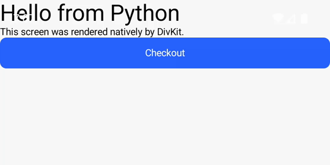

# Latawiec

**Latawiec** (Polish for *kite*) — native mobile apps flown from a Python backend.

A kite flies in the sky, but the string stays in your hand. Latawiec works the same way:
screens are written in Python on your server, and a thin native shell on the phone renders
them natively with [DivKit](https://divkit.tech). Change the Python, and the app changes —
no app release, no Kotlin, no Swift.

```python
import latawiec as lt

app = lt.Latawiec()


@app.screen("home")
def home() -> lt.Component:
    return lt.Column(
        lt.Text("Hello from the server", size=24),
        lt.Button("Open checkout", on_tap=lt.Navigate("checkout")),
    )
```

`app` is a regular ASGI/FastAPI app — `uvicorn main:app` serves the rendered screen at
`/screens/home`.



*The dev loop: save the Python file, `uvicorn --reload` restarts the server, the shell
reconnects over WebSocket and renders the fresh screen — no rebuild, no reinstall.*

## Status

Early development, built in public. Working today: a small Python DSL (text, image,
column/row, buttons, text inputs with on-device variables), a FastAPI server that exposes
screens as DivKit card JSON, and native shells for **Android and iOS** that render screens
from that server with live reload, real navigation, and forms — a Submit button POSTs the
screen's values to a Python handler, which answers with where to go next. The component
set is still small, and nothing ships to the app stores for you yet.

## How it will work

```text
Python DSL (sdk-python/)  →  DivKit JSON over HTTP/WebSocket  →  native shell (Android/iOS)
```

- **sdk-python/** — the `latawiec` package: component DSL built on
  [pydivkit](https://pypi.org/project/pydivkit/) and the FastAPI-based screen server.
- **shell-android/** — a thin, fully native Kotlin app: DivKit renders whatever the server
  sends. No Flutter, no React Native, no webview.
- **shell-ios/** — the same, in Swift (UIKit + DivKit); screens push onto a real
  UINavigationController, so back is the system back.
- **mcp** (the `latawiec[mcp]` extra) — an MCP server so coding agents can build and
  preview Latawiec apps; see "For coding agents" below.

## For coding agents

The `latawiec[mcp]` extra ships an MCP server (`latawiec-mcp`, stdio) so agents can learn
the DSL (`reference`), list an app's screens, and render any screen to its DivKit JSON
without a server or a phone. Register it from `sdk-python/`:

```json
{ "mcpServers": { "latawiec": { "command": "uv", "args": ["run", "latawiec-mcp"] } } }
```

## Development

The Python side needs [uv](https://docs.astral.sh/uv/):

```sh
cd sdk-python
uv sync
uv run pytest
```

To see a screen on a phone, start the example server and install the shell on a running
emulator (the shell's default server URL is the emulator's host loopback):

```sh
cd sdk-python && uv run uvicorn examples.hello:app --host 0.0.0.0 --reload
cd shell-android && ./gradlew installDebug   # physical device: add -PserverUrl=http://<mac-ip>:8000
```

The iOS shell needs [XcodeGen](https://github.com/yonaskolb/XcodeGen) once
(`brew install xcodegen`); the simulator reaches the same server on the Mac's loopback:

```sh
cd shell-ios && xcodegen generate && open LatawiecShell.xcodeproj   # run on a simulator
```

Edit `examples/hello.py` while both are running and the phone follows your saves.
`examples/catalog.py` is a bigger app: a product list whose screens are generated
from plain Python data in a loop.

## License

Apache-2.0
